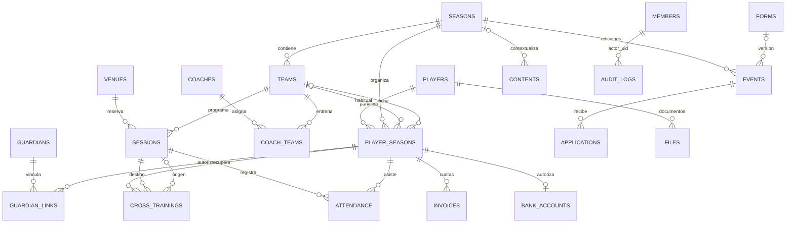
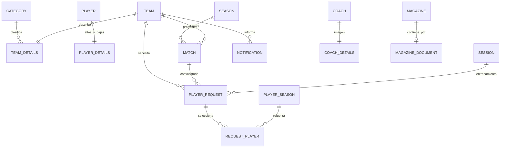

# Modelo implementado en la primera entrega

Fuente ejecutable: `database/001_initial.sql`. No representa todavía todo el modelo ampliado de los informes. Las claves compuestas garantizan que asignaciones, sesiones y solicitudes pertenecen a la misma temporada.

`members.uid` corresponde al UID Firebase y es único. `audit_logs.actorUid` no es una FK porque conserva actores históricos/sistema aunque se retire una cuenta. Los roles están restringidos en SQL y los equipos de alcance se validan en servidor. El diagrama expresa esta asociación lógica.

El IBAN y el documento del titular se almacenan cifrados en `bank_accounts`; solo `last4` se devuelve al panel. Formularios guardan la definición versionada en JSONB, mientras que las solicitudes preservan respuestas y referencia al evento. La primera versión bloquea cambiar el formulario de una edición con solicitudes.

Restricciones probadas: una temporada actual, fechas de temporada/sesión/evento coherentes, equipos de la misma temporada, reserva de pista sin solapamientos activos, asistencia/recuperación no duplicada, referencia idempotente de solicitud, cuota coherente con jugador-temporada, versiones usadas inmutables y auditoría sin edición/borrado.

Ampliaciones posteriores: ficha federativa con número/vigencia y varias licencias, identidades de directiva, movimientos históricos, pagador independiente, mandatos firmados, pagos parciales, devoluciones, remesas y toda la estructura de competición del informe. No se han creado tablas vacías pretendiendo que esos procesos ya estén implementados.

## Ampliación de operaciones del club (27/10/2026)

El catálogo incluye Escuelita, Babybasket, Benjamín, Alevín, Infantil, Cadete, Júnior, Sub-22 y Sénior. Categoría, año, grupo y división se mantienen separados. Las ramas del club son Femenino y Masculino. La ordenación de categorías y grupos constituye la regla interna de subidas; no sustituye la validación federativa específica de cada competición.

`coach_teams.function` diferencia HEAD, ASSISTANT y FORMER. Hay índices únicos para un primer y un segundo entrenador por equipo. El alta de equipos exige primer entrenador. La vinculación deportiva no crea una cuenta de acceso: un administrador debe autorizar el correo y los equipos de ese entrenador.

`matches` contiene rival, fechas de inicio/final, casa/fuera, instalación, competición, estado, marcador, publicación y origen de ejemplo. `player_requests` separa solicitudes puntuales de partido y entrenamientos continuados. `request_players` registra las personas autorizadas sin mover su equipo habitual ni licencia. Una autorización continuada se aplica a nuevas sesiones del equipo desde su fecha efectiva.

`player_details` conserva fecha de incorporación conocida, baja, revisión y marca de anonimización. La ficha se puede anonimizar de forma confirmada; los documentos, las cuentas económicas, las auditorías y los datos de otras aplicaciones requieren revisión separada. Los avisos semanales no suprimen automáticamente información.

Revistas y actividades del club no tienen FK a temporada. Los PDFs de hasta 2 MiB se guardan en `magazine_documents` en PostgreSQL a través de SQL Connect, separados de las consultas del panel. Solo se ofrecen públicamente cuando la edición está publicada.
